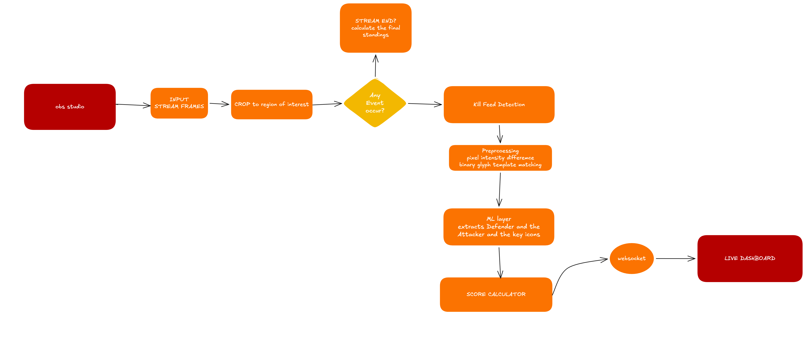
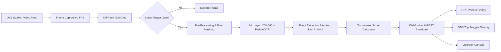
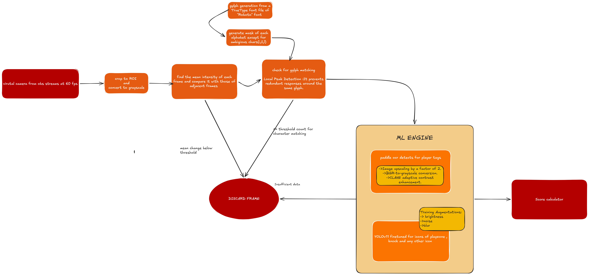
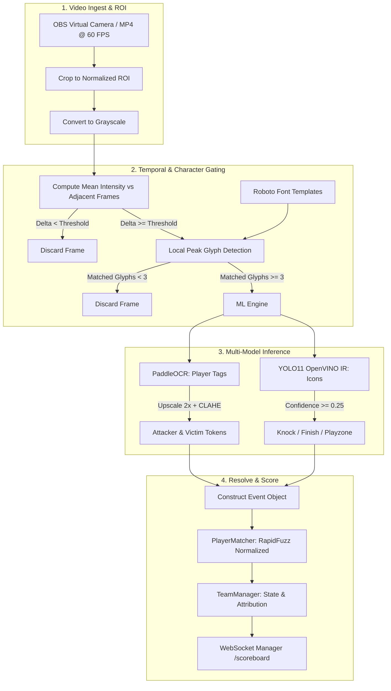

# 🎯 BGMI Live Kill-Feed Parser & Real-Time Esports Scoreboard Engine

> **A high-performance, automated computer-vision and tournament-scoring suite for Battlegrounds Mobile India (BGMI / PUBG Mobile).**  
> Ingests live gameplay streams via OBS Studio or video files, detects HUD kill-feed events in real time using temporal change gating, glyph template matching, PaddleOCR, and a fine-tuned YOLO11 model running on OpenVINO, and broadcasts live points tables and MVP overlays to production stream graphics via WebSockets.

---

[](pyproject.toml)
[](backend/main.py)
[](best_openvino_model/metadata.yaml)
[](best_openvino_model/metadata.yaml)
[](model_experiments/ocr.py)
[](backend/websocketManager.py)
[](frontend/overlay.html)
[](LICENSE)
[](#contributing)

---

## 📑 Table of Contents
1. [Overview & Highlights](#-overview--highlights)
2. [System Architecture](#-system-architecture)
   - [High-Level Design (HLD)](#1-high-level-design-hld)
   - [Low-Level Design (LLD)](#2-low-level-design-lld)
3. [Core Feature Breakdown](#-core-feature-breakdown)
   - [AI Vision & Kill-Feed Detection Pipeline](#1-ai-vision--kill-feed-detection-pipeline)
   - [Official Tournament Scoring & Kill Attribution](#2-official-tournament-scoring--kill-attribution)
   - [Broadcast Graphics Suite for OBS Studio](#3-broadcast-graphics-suite-for-obs-studio)
   - [Operator Console & Match Management](#4-operator-console--match-management)
4. [Repository Structure](#-repository-structure)
5. [Installation & Setup](#-installation--setup)
6. [Usage Guide](#-usage-guide)
   - [Running the FastAPI Server](#1-launch-the-backend--broadcast-server)
   - [Running the Video Vision Pipeline](#2-run-the-ai-vision-pipeline)
   - [Using OBS Studio Browser Sources](#3-obs-studio-browser-source-setup)
7. [API & WebSocket Reference](#-api--websocket-reference)
8. [Tournament Scoring Rules (BGIS Standard)](#-tournament-scoring-rules-bgis-standard)
9. [Contributing](#-contributing)
10. [License](#-license)

---

## 🌟 Overview & Highlights

In high-stakes BGMI esports tournaments, kill-feed events occur in fractions of a second across multiple skirmishes. Traditional manual scoring is prone to operator fatigue, delayed leaderboard updates, and misattributed finishes.

This system replaces manual tracking with an **automated, end-to-end broadcast workflow**:
- **95%+ Compute Reduction**: A dual-stage temporal change detector and Roboto-glyph correlation filter drops idle frames before heavy ML models are even invoked.
- **Hardware-Accelerated Computer Vision**: Intel OpenVINO runtime executes a fine-tuned YOLO11 model to detect weapon/action icons (`knock`, `object`/finish, `playzone`), paired with an enhanced PaddleOCR pass for gamer tags.
- **Strict BGMI Kill Attribution**: Accurately credits kills to the original knocker when a teammate secures the finish, handles third-party kill steals, and manages playzone bleed-outs.
- **Zero-Latency Broadcast Overlays**: Dark, 100% opaque, broadcast-grade graphics for OBS Studio with independent channel controls for both Points Tables and Top Fragger / MVP spotlight widgets.
- **Operator Control & Persistence**: Real-time management console with live standings, manual score adjustment grids, undo functionality, ROI calibrator, and instant CSV export.

---

## 🏛 System Architecture

The system is built as a decoupled, multi-tier architecture connecting the real-time computer vision stream directly to tournament management and graphics playout.

### 1. High-Level Design (HLD)

The high-level pipeline processes video streams from OBS Studio or files, detects kill-feed changes, performs ML inference, calculates scores, and distributes snapshots to live dashboards and stream graphics.





---

### 2. Low-Level Design (LLD)

The low-level design outlines the inner mechanics of the computer vision filter, glyph template matching, model augmentations, and discard criteria.





---

## 🚀 Core Feature Breakdown

### 1. AI Vision & Kill-Feed Detection Pipeline
- **Temporal Difference Gate (`preprocess/change_detector.py`)**: Computes mean pixel intensity differences between successive frames with a cooldown timer (0.40s). Drops static frames without processing.
- **Font Glyph Correlation (`preprocess/matching.py`)**: Validates candidate frames using pre-rendered binary masks of the official BGMI HUD font (`fonts/RobotoCondensed-Bold.ttf`). Rejects non-text visual noise (muzzle flashes, smoke, UI popups).
- **YOLO11 OpenVINO Detection (`model_experiments/pipeline.py`)**: Runs on Intel OpenVINO runtime for sub-10ms CPU inference. Detects:
  - `knock` (Crossed rifles icon)
  - `object` (Finish / elimination crate / skull icon)
  - `playzone` (Blue zone icon)
- **Enhanced OCR (`model_experiments/ocr.py`)**: Uses PaddleOCR with $2\times$ bilinear upscaling and CLAHE (Contrast Limited Adaptive Histogram Equalization) to read low-contrast nicknames, clan tags, and special characters.

---

### 2. Official Tournament Scoring & Kill Attribution
- **Accurate Teammate Finish Attribution**: If Player **A** knocks Enemy **B**, and Teammate **C** (on Player **A**'s team) finishes Enemy **B**, the kill is **credited exclusively to Player A** according to official BGMI rules.
- **Third-Party Kill Steals**: If a third-party team finishes a knocked enemy, the kill is awarded to the third-party finisher.
- **Bleed-Out & Playzone Attribution**: If a knocked player bleeds out or dies to the blue zone, the elimination is attributed to the original knocker.
- **Lingering Frame & Duplicate Guard**: BGMI kill-feed banners remain visible on screen for ~3 seconds. The engine automatically rejects duplicate detections of already-eliminated players to prevent inflated scores.
- **Placement Points Engine**: Tracks team eliminations sequentially and awards official BGIS placement points (1st: 10, 2nd: 6, 3rd: 5, 4th: 4, 5th: 3, 6th: 2, 7th: 1, 8th: 1). Automatically awards the +4 Chicken Dinner bonus to the last surviving squad.

---

### 3. Broadcast Graphics Suite for OBS Studio
The system provides two independent, 100% opaque, broadcast-grade browser overlays designed for esports streams:

#### A. Points Table Overlay (`frontend/overlay.html`)
- **Chassis**: Ultra-compact 240px width that fits 16+ teams with zero horizontal overflow.
- **Visuals**: Solid `#0B0E14` military background, sharp borders, BGMI `#F97316` orange accent bar, and tabular figures.
- **Dynamic Highlights**: Top 3 ranks highlighted in Gold (`#F59E0B`), Silver (`#38BDF8`), and Bronze (`#D97706`).
- **Live Animations**: Real-time points flash animation whenever a team scores kills or placement points.
- **Elimination State**: Faded opacity with red `OUT` status tags for eliminated squads.

#### B. Standalone Top Fragger & MVP Overlay (`frontend/fraggers_overlay.html`)
- **Independent OBS Channel**: Add as a separate browser source to place anywhere on stream.
- **Mode 1 - Top 5 Leaderboard**: Ranks top 5 tournament fraggers with team color strip, player name, team tag, live status chip (`ALIVE`, `KNK`, `OUT`), and kill counts.
- **Mode 2 - Match MVP Spotlight**: High-impact lower-third widget featuring a golden crown badge, team badge, large player name, and dedicated Kill and Knock counters.
- **Remote Visibility & Mode Toggling**: Controlled directly from the Operator Console.

---

### 4. Operator Console & Match Management
- **Live Status Strip (`frontend/console.html`)**: Real-time summary of Total Kills, Teams Alive, Map, Leading Team, and Top Fragger (MVP).
- **Broadcast Overlays Control**: Live show/hide toggles for both overlays, display mode switcher (`Top 5 List` $\leftrightarrow$ `MVP Card`), and one-click OBS URL copy buttons.
- **Manual Scoring & Intervention Grid**: Interactive team cards allowing operators to manually score kills (`+1`, `−1`), record knocks, or mark team eliminations with single clicks.
- **Roster Presets**: One-click switching between Default Tournament Teams, Video Testing Teams, and the official **16-Team BMSD Pro Roster** (NINZ, 8BIT, RNTX, BLEG, TAG, NBE, SOUL, K9, V1BA, GODL, OR, GDR, MYTH, WELT, GEN, WF).
- **Match Lifecycle**: Pause, Resume, End Match, Start New Match, and 1-click Undo.
- **History & CSV Export (`frontend/history.html`)**: Aggregates standings across multiple tournament matches and exports official standings to CSV.

---

## 📂 Repository Structure

```text
HACKTOBERFEST-WEEK-2-CHALLENGE/
├── backend/                        # Tournament Engine & FastAPI Server
│   ├── main.py                     # API routes, static mounts, WebSocket handler
│   ├── state.py                    # StateStore: JSON persistence, snapshots, rosters
│   ├── teamManager.py              # Kill attribution, placement points, status
│   ├── playerMatcher.py            # RapidFuzz fuzzy OCR name resolution & aliases
│   ├── websocketManager.py         # Sub-millisecond WebSocket broadcast manager
│   ├── events.py                   # Event, Icon, and Match dataclasses
│   ├── teams.py                    # Team, Player, and PlayerStatus definitions
│   └── pipeline_debugger.py        # Frame candidate verification & API sync
├── frontend/                       # Broadcast & Operator Web Interfaces
│   ├── console.html                # Live Operator Console with scoring controls
│   ├── overlay.html                # OBS Points Table Overlay (compact 240px)
│   ├── fraggers_overlay.html       # OBS Standalone Top Fraggers & MVP Overlay
│   ├── setup.html                  # Tournament setup, roster editor & ROI calibrator
│   ├── history.html                # Cumulative match history & CSV export
│   └── styles.css                  # Shared dark esports design system
├── preprocess/                     # Frame Ingest & Gating Pipeline
│   ├── pipeline.py                 # Video reader & candidate orchestrator
│   ├── change_detector.py          # Temporal pixel-difference gate (cooldown 0.4s)
│   ├── matching.py                 # OpenCV font-mask template matching
│   ├── roi.py                      # Frame cropping, resizing & thresholding
│   ├── config.py                   # Video paths, ROI ratios & gate thresholds
│   └── output.py                   # Diagnostic image output & candidate logs
├── model_experiments/              # ML Models & OCR Inference
│   ├── pipeline.py                 # Dual YOLO11 + PaddleOCR extraction
│   ├── ocr.py                      # SingleRowKillfeedOCR (CLAHE + token parser)
│   └── train.py                    # YOLO11 fine-tuning script
├── best_openvino_model/            # Intel OpenVINO IR Model Artefacts
│   ├── best.xml                    # OpenVINO XML model graph
│   ├── best.bin                    # Quantized model weights
│   └── metadata.yaml               # YOLO11n class mappings (knock, object, playzone)
├── system_design/                  # Architecture & Design Diagrams
│   ├── HLD.png                     # High-Level Architecture Diagram
│   └── LLD.png                     # Low-Level Pipeline & CV Gate Diagram
├── data/                           # Persistent JSON Storage (auto-generated)
│   ├── roster.json                 # Active team roster & OCR aliases
│   ├── settings.json               # Tournament title, active map, point rules
│   ├── current_match.json          # Live match state, scores, player frags
│   ├── history.json                # Archived matches & cumulative standings
│   └── roi_config.json             # Calibrated kill-feed crop coordinates
├── fonts/                          # Roboto Condensed font files for glyph masks
├── main.py                         # Root end-to-end video pipeline runner
├── pyproject.toml                  # Project dependencies & Python metadata
└── uv.lock                         # Locked reproducible dependency graph
```

---

## ⚙️ Installation & Setup

### Prerequisites
- **Python 3.12+**
- **[uv](https://docs.astral.sh/uv/)** (recommended) or standard `pip`

### 1. Clone & Install Dependencies
```powershell
# Clone the repository
git clone https://github.com/Satvik-Singh192/HACKTOBERFEST-WEEK-2-CHALLENGE.git
cd HACKTOBERFEST-WEEK-2-CHALLENGE

# Install dependencies using uv
uv sync

# Or using standard pip
python -m venv .venv
.venv\Scripts\activate
pip install -e .
pip install rapidfuzz
```

---

## 🎮 Usage Guide

### 1. Launch the Backend & Broadcast Server
Start the FastAPI server:
```powershell
uv run uvicorn backend.main:app --reload --port 8000
```
> The server automatically launches the setup page (`http://127.0.0.1:8000/frontend/setup.html`) in your browser upon startup.

### 2. Run the AI Vision Pipeline
To process video footage (or OBS virtual camera recording):
```powershell
uv run python main.py
```
This reads the video feed, extracts candidate frames, classifies icons using OpenVINO YOLO11, reads player names with PaddleOCR, and automatically pushes events to the live server.

### 3. OBS Studio Browser Source Setup

Add the broadcast overlays to your OBS Studio scene:

| Overlay | OBS Source URL | Recommended Size | Notes |
| :--- | :--- | :--- | :--- |
| **Points Table Overlay** | `http://127.0.0.1:8000/frontend/overlay.html` | `260 × 720` | Compact sidebar, fits 16 teams |
| **Top Fraggers Overlay** | `http://127.0.0.1:8000/frontend/fraggers_overlay.html` | `310 × 340` | Standalone widget or lower-third |

#### OBS URL Parameters:
- **Lock to MVP Mode**: `http://127.0.0.1:8000/frontend/fraggers_overlay.html?mode=mvp`
- **Lock to Top 5 Mode**: `http://127.0.0.1:8000/frontend/fraggers_overlay.html?mode=top5`
- **Bypass Remote Hide**: Add `?force=1` to keep visible regardless of operator console toggles.

---

## 📡 API & WebSocket Reference

### HTTP Endpoints

| Method | Endpoint | Description |
| :--- | :--- | :--- |
| `GET` | `/scoreboard` | Retrieve the complete real-time match snapshot (teams, MVP, fraggers, overlay status) |
| `POST` | `/api/event` | Submit a parsed kill-feed event (`attacker`, `icons`, `victim`) from the CV pipeline |
| `POST` | `/api/kill` | Manually increment or decrement kills for a team/player |
| `POST` | `/api/knock` | Record a knock for a team/player |
| `POST` | `/api/eliminate` | Mark an entire squad eliminated and trigger placement scoring |
| `POST` | `/api/undo` | Undo the most recent scoring action |
| `GET` | `/api/overlay/config` | Get current visibility and mode of broadcast overlays |
| `POST` | `/api/overlay/config` | Remotely toggle overlay visibility or switch fragger display modes |
| `POST` | `/api/match/status` | Update match lifecycle (`LIVE`, `PAUSED`, `FINISHED`) |
| `POST` | `/api/reset` | Reset the current match state for a fresh game |
| `GET` | `/api/roster` | Fetch the registered tournament roster and players |
| `POST` | `/api/roster/load-bmsd` | Load the official 16-team BMSD Pro tournament roster |
| `GET` | `/api/history` | Retrieve cumulative tournament standings across matches |
| `GET` | `/api/history/export-csv`| Download official tournament standings as a CSV file |

### WebSocket Endpoint
- **URL**: `ws://127.0.0.1:8000/scoreboard`
- **Protocol**: Broadcasts full JSON snapshot whenever scores, kills, fraggers, or overlay settings change.
- **Client Auto-Reconnect**: Frontend clients include automated 2-second heartbeat reconnects and REST polling fallbacks.

---

## 🏆 Tournament Scoring Rules (BGIS Standard)

### Placement Points Distribution
```text
┌──────────────┬────────┬──────────────┬────────┐
│ Rank         │ Points │ Rank         │ Points │
├──────────────┼────────┼──────────────┼────────┤
│ 1st (WWCD)   │ 10 pts │ 5th Place    │ 3 pts  │
│ 2nd Place    │  6 pts │ 6th Place    │ 2 pts  │
│ 3rd Place    │  5 pts │ 7th Place    │ 1 pt   │
│ 4th Place    │  4 pts │ 8th Place    │ 1 pt   │
│ 9th - 16th   │  0 pts │              │        │
└──────────────┴────────┴──────────────┴────────┘
```
- **Kill Points**: **1 point** per kill.
- **Kill Attribution**: Kills belong to the knocker if completed by a teammate.
- **Total Points Formula**: $\text{Total Points} = \text{Placement Points} + \text{Kill Points}$.

---

## 🤝 Contributing

Contributions are welcome! Please follow these steps:
1. Fork the repository and create your feature branch: `git checkout -b feature/amazing-feature`.
2. Ensure Python syntax compiles cleanly:
   ```powershell
   uv run python -m compileall backend preprocess model_experiments main.py
   ```
3. Test event attribution logic:
   ```powershell
   uv run python backend/teamManager.py
   ```
4. Commit your changes and open a descriptive Pull Request.

---

## 📄 License

This project is open-source and distributed under the [MIT License](LICENSE).
The fine-tuned YOLO11 model export is governed by the Ultralytics license.
Roboto Condensed font files are governed by the Apache 2.0 License.
