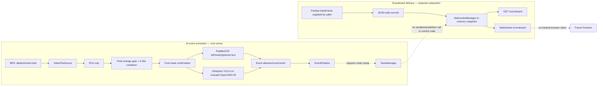

# Live BGMI Kill Feed Parser & Points Table Maintainer

> An AI-assisted research prototype for turning BGMI kill-feed footage into structured events, then providing the building blocks for tournament scoring and live scoreboard delivery.

[](pyproject.toml)
[](#contributing)
[](best_openvino_model/metadata.yaml)

BGMI broadcasts expose eliminations as fast-changing HUD text and icons. Reading each event and updating a table by hand is slow and error-prone. This repository explores an assistive workflow: narrow a video to likely kill-feed changes, recognise the two names with OCR, classify feed icons with a trained detector, and represent the result as an `Event` that can be checked against a tournament roster.

It is aimed at tournament tools developers, stream-production teams, computer-vision contributors, and Hacktoberfest contributors—not at an already-deployed scoring service. The strongest implemented path is the AI candidate-to-event pipeline. Roster initialisation, conversion to a published table, and UI integration still need wiring.

## What is here today

| Area | Status | Evidence |
| --- | --- | --- |
| MP4 frame reading and kill-feed ROI cropping | Implemented | [preprocess/pipeline.py](preprocess/pipeline.py), [preprocess/roi.py](preprocess/roi.py) |
| Candidate filtering by pixel changes, cooldown, and font masks | Implemented | [preprocess/change_detector.py](preprocess/change_detector.py), [preprocess/matching.py](preprocess/matching.py) |
| OCR + icon detection creating `Event` objects | Implemented, input-dependent | [model_experiments/ocr.py](model_experiments/ocr.py), [model_experiments/pipeline.py](model_experiments/pipeline.py) |
| OpenVINO IR model artefact | Included | [model metadata](best_openvino_model/metadata.yaml) |
| Fuzzy roster-name matching and in-memory event scoring classes | Implemented as library code | [backend/playerMatcher.py](backend/playerMatcher.py), [backend/teamManager.py](backend/teamManager.py) |
| DataFrame-to-JSON scoreboard snapshots and WebSocket broadcast manager | Implemented as library code | [backend/scoreboard.py](backend/scoreboard.py), [backend/websocketManager.py](backend/websocketManager.py) |
| FastAPI read-only snapshot/WebSocket service | Partially implemented | [backend/main.py](backend/main.py) |
| Browser frontend | Not implemented in the tracked tree | `frontend/` contains only a short note |
| CSV upload, CSV watcher, persistence, authentication, automatic end-to-end publishing | Not implemented | No tracked code invokes those workflows |

## Architecture and integration reality



`main.py` connects preprocessing, OCR/detection, and `EventPipeline`; it does **not** register teams or call `initialize_player_matcher()`. Consequently, once an event is recognised, `TeamManager.resolve_event()` raises until an application supplies a roster and initialises the matcher. Separately, nothing calls the WebSocket manager’s update methods from the event path. This distinction is intentional in the diagram: it prevents a misleading claim of a finished live scoreboard.

## AI implementation

### 1. Candidate generation

`VideoFileSource` sequentially reads the first configured portion of a local MP4. `crop_killfeed_roi()` takes a normalized rectangle from each frame; the default is `x=0.005–0.265`, `y=0.272–0.355` of frame dimensions. `PixelChangeDetector` emits only a threshold crossing at mean grayscale difference `>= 12.0` after a `0.40 s` cooldown.

Each triggered crop is resized to `333 × 60`, thresholded at 150, and compared with glyph masks rendered from `fonts/RobotoCondensed-Bold.ttf`. At least three non-overlapping character-template matches at correlation `>= 0.68` are required before the crop reaches ML inference. The pipeline saves diagnostic crops, binary masks, match overlays, plus `candidates.csv` and `detections.csv` under `output/mask_detection/`. These CSVs are diagnostics—not a live score source.

### 2. Recognition and detection

`SingleRowKillfeedOCR` doubles the crop size, applies CLAHE, then uses PaddleOCR in English with permissive detection thresholds. OCR tokens below the configured confidence are discarded; the leftmost surviving token becomes `attacker` and the rightmost becomes `victim`. This is a layout heuristic, not a roster-aware parser.

`KillfeedPipeline` also calls `ultralytics.YOLO(...).predict()` over the crop. The supplied IR metadata identifies a YOLO11n detection export with classes `knock`, `object`, and `playzone`, at 352 × 352. Recognised class names are mapped to `Icon.KNOCK`, `Icon.OBJECT`, and `Icon.PLAYZONE`. Current code collects all recognised icon classes and does not enforce that a detected icon lies spatially between the OCR names; the earlier spatial-association logic is commented out. No accuracy, provenance beyond the metadata, or runtime benchmark is claimed here.

The resulting dataclass is:

```python
Event(attacker: str | None, icons: list[str], victim: str)
```

Although `icons` is annotated as `list[str]`, the ML pipeline supplies `Icon` string-enum values. An event may therefore contain zero, one, or several mapped icon labels.

## Event, roster, and scoring behaviour

`TeamManager` stores `Team` objects, `Player` objects, a player-to-team map, last-knocker attribution, and a count of eliminated teams. Add teams first and call `initialize_player_matcher()` before `process_events()`.

`PlayerMatcher` uppercases names and removes non-alphanumerics. It accepts a unique normalized exact match; otherwise it uses RapidFuzz ratio matching only for normalized strings of length at least five, requiring a score of at least 85 and an 8-point lead over the next candidate. Ambiguous or low-confidence names reject the event with `ValueError`.

- A `KNOCK` with a non-null attacker marks the victim `KNOCKED` and stores the attacker as `last_knocked_by`.
- An `OBJECT` marks the victim `ELIMINATED`, checks the victim’s team, and awards one kill to an opposing finisher; if a teammate finishes the victim, or the attacker is absent, a previously recorded opposing knocker can receive the kill instead.
- `PLAYZONE` is special-cased during name resolution when the attacker string case-folds to `playzone`. The finish branch compares the resolved value to `"Playzone"`, so zone-event attribution deserves tests before relying on it in a match.
- There is no duplicate-event guard, revive handling, validation that a victim was previously knocked, or persistent match state.

Placement is not the commonly assumed 10/6/5/4/... table. When an entire team is eliminated, its placement is calculated from registered-team count and elimination order. On placements `{8, 6, 5, 4, 3, 2}`, every still-alive unplaced team receives one placement point. The last surviving team is assigned placement 1 and receives four additional points. Player kills and team placement points are kept separately; there is no total-points formula or scoreboard serializer for `Team` objects.

## Repository map

```text
.
├── main.py                     # MP4 → candidate → OCR/YOLO → EventPipeline runner
├── preprocess/
│   ├── config.py               # Video, ROI, filtering, and template defaults
│   ├── pipeline.py             # Frame source and candidate orchestration
│   ├── roi.py                  # Crop/resize/binary conversion
│   ├── change_detector.py      # Temporal change gate
│   ├── mask_generator.py       # Generates glyph templates from the bundled font
│   ├── templates.py            # Loads generated masks
│   ├── matching.py             # OpenCV template matching and overlap suppression
│   └── output.py               # Diagnostic images and CSV reports
├── model_experiments/
│   ├── pipeline.py             # PaddleOCR + YOLO event extraction
│   ├── ocr.py                  # OCR preprocessing and token extraction
│   └── train.py                # YOLO11n training experiment
├── backend/
│   ├── events.py               # Event and Icon definitions
│   ├── teams.py                # Team/player state data classes
│   ├── playerMatcher.py        # Fuzzy roster matching
│   ├── teamManager.py          # State transitions, kills, placement logic
│   ├── event_pipeline.py       # Event-to-TeamManager adapter
│   ├── scoreboard.py           # DataFrame JSON-safety conversion
│   ├── websocketManager.py     # Snapshot storage and broadcast manager
│   └── main.py                 # FastAPI application
├── best_openvino_model/        # `best.xml`/`best.bin` plus Ultralytics metadata
├── fonts/                      # Roboto Condensed font files used for templates
├── pyproject.toml              # Python 3.12+ project metadata
└── uv.lock                     # Locked dependency graph
```

## Requirements and setup

- Python 3.12 or newer (`.python-version` pins `3.12`)
- [uv](https://docs.astral.sh/uv/) for the declared workflow
- A local gameplay video at `data/trimmed.mp4` for the root runner (the `data/` directory is intentionally ignored)
- The included `best_openvino_model/` files and fonts must remain in place

```powershell
git clone https://github.com/Satvik-Singh192/HACKTOBERFEST-WEEK-2-CHALLENGE.git
Set-Location HACKTOBERFEST-WEEK-2-CHALLENGE
uv sync
```

### Important setup limitation

`backend/playerMatcher.py` imports `rapidfuzz`, but `rapidfuzz` is not declared in the current `pyproject.toml` dependency list (even though an unused lock entry exists). The root runner imports that module, so a clean environment may need this temporary local workaround:

```powershell
uv pip install rapidfuzz
```

The durable fix should be a small contribution that adds it to the project dependencies and refreshes `uv.lock`; do not treat the workaround as a production deployment recipe.

## Configuration

Configuration is Python constants in [preprocess/config.py](preprocess/config.py), not environment variables or `.env` files.

| Setting | Default | Meaning |
| --- | --- | --- |
| `VIDEO_PATH` | `data/trimmed.mp4` | Local MP4 input |
| `DURATION_SECONDS` | `300` | Maximum video seconds processed; `None` processes all frames |
| `XMIN_RATIO`, `XMAX_RATIO` | `0.005`, `0.265` | Horizontal kill-feed ROI ratios |
| `YMIN_RATIO`, `YMAX_RATIO` | `0.272`, `0.355` | Vertical kill-feed ROI ratios |
| `DIFF_THRESHOLD` / `COOLDOWN_SECONDS` | `12.0` / `0.40` | Candidate temporal gate |
| `MASK_MATCH_THRESHOLD` / `MIN_MATCHED_LETTERS` | `0.68` / `3` | Font-template confirmation gate |
| `OUTPUT_DIR` | `output/mask_detection` | Generated diagnostics |
| Root-runner ML thresholds | OCR `0.50`, YOLO `0.25`, size `352` | Passed in [main.py](main.py) |

Tune the ROI for the broadcast resolution and HUD layout being processed. The detector artifact is loaded from `./best_openvino_model/` in [main.py](main.py); no alternative model-path CLI or environment configuration exists.

## Running the available pieces

### AI event-extraction experiment

After providing the MP4 and completing setup:

```powershell
uv run python main.py
```

This creates preprocessing diagnostics and attempts OCR/detection. As written, it then sends an `Event` to an unconfigured `TeamManager`; expect roster-initialisation failure on the first recognised event. You can still use [preprocess/pipeline.py](preprocess/pipeline.py) directly with no callback for candidate diagnostics, or extend the root runner with an explicit roster before using it for scoring.

### FastAPI snapshot service

`backend/main.py` uses local (non-package-qualified) imports. Run it from its directory:

```powershell
Set-Location backend
uv run uvicorn main:app --reload
```

The server has an in-memory empty snapshot on startup. It does not receive ML events or load a CSV by itself.

## API and WebSocket reference

| Method | Path | Current behaviour |
| --- | --- | --- |
| `GET` | `/` | Returns `{"message": "BGMI Live Scoreboard Backend"}` |
| `GET` | `/scoreboard` | Returns the current in-memory snapshot |
| WebSocket | `/scoreboard` | Accepts the connection and immediately sends the current snapshot |

The initial HTTP/WebSocket snapshot is:

```json
{"version": 0, "teams": []}
```

`WebsocketManager.update_dataframe()` can transform a Pandas DataFrame into JSON-compatible row records and increment/broadcast the version, but no HTTP route or file watcher invokes it. The WebSocket handler waits for text frames only to keep the connection alive; client messages do not change state. There is no authentication, CORS configuration, upload endpoint, reconnect logic, or frontend client in the current tree.

## Testing and validation

There is no tracked test suite or lint configuration. `teamManager.py` includes a small executable assertion example under its `if __name__ == "__main__"` block, but it is not a formal test and requires `rapidfuzz`.

Useful checks for contributors:

```powershell
uv run python -m compileall backend preprocess model_experiments main.py
uv run python backend/teamManager.py
```

For a change to the AI path, validate it against a representative local MP4 and inspect the generated diagnostics before opening a pull request. Do not commit source footage, generated `output/`, `font_templates/`, virtual environments, or model reruns unless maintainers ask for them.

## Hacktoberfest contributions

Small, reviewable contributions are especially valuable here. Good first issues include:

- add unit tests for `PixelChangeDetector`, player matching thresholds, kill attribution, and placement scoring;
- declare `rapidfuzz` in `pyproject.toml` and regenerate the lock file;
- add a roster configuration format and initialise `TeamManager` in the root runner;
- turn `Team` state into a defined scoreboard schema and publish it through `WebsocketManager`;
- restore icon-to-name spatial association and add fixtures for OCR/detection edge cases;
- build the missing frontend client for the documented snapshot contract;
- expose the ROI and model path safely through a documented configuration layer.

Please keep each pull request focused:

1. Fork the repository and create a descriptive branch, for example `docs/clarify-ai-pipeline`.
2. Make the smallest coherent change and update documentation when behaviour changes.
3. Run the relevant checks above; include the exact result in the PR description.
4. Explain what input data was used for vision changes without committing private gameplay footage.
5. Open a PR with the problem, approach, validation, and known limitations.

Avoid silently changing tournament rules or representing a prototype as production-ready. Issues and PRs that improve determinism, auditability, error handling, and test coverage are particularly reviewer-friendly.

## Known limitations and roadmap

Confirmed current gaps:

- no tracked UI, roster file, match lifecycle, database, CSV ingestion/watcher, or persistence;
- ML events are not serialised into the WebSocket snapshot;
- root scoring has no registered teams and so cannot resolve recognised names;
- candidate detection currently supports a local MP4, not a configured live/OBS source;
- model icon detections are not spatially associated with OCR text, and duplicate feed entries can be scored repeatedly;
- model identity and license observable from metadata are Ultralytics YOLO11n / AGPL-3.0 for the export metadata; dataset provenance, evaluation metrics, and suitability for a specific tournament are not documented;
- no repository license file has been identified.

The practical roadmap is to establish a versioned roster and scoreboard contract, connect `TeamManager` to that contract, publish each accepted update, add a browser overlay, then harden the vision path with labelled fixtures, deduplication, metrics, and end-to-end tests.

## Demo

No project demo video, screenshots, deployment URL, or sample input footage is tracked. Add real, reproducible assets here when they are available—please do not replace this section with synthetic claims.

## Acknowledgements

The implementation uses FastAPI, OpenCV, PaddleOCR/PaddlePaddle, Pandas, Pillow, and Ultralytics. The bundled model metadata names Ultralytics and links its AGPL-3.0 license; see [best_openvino_model/metadata.yaml](best_openvino_model/metadata.yaml). Roboto Condensed font files are bundled under [fonts/](fonts/).

## License

This project is distributed under the [MIT License](LICENSE).

